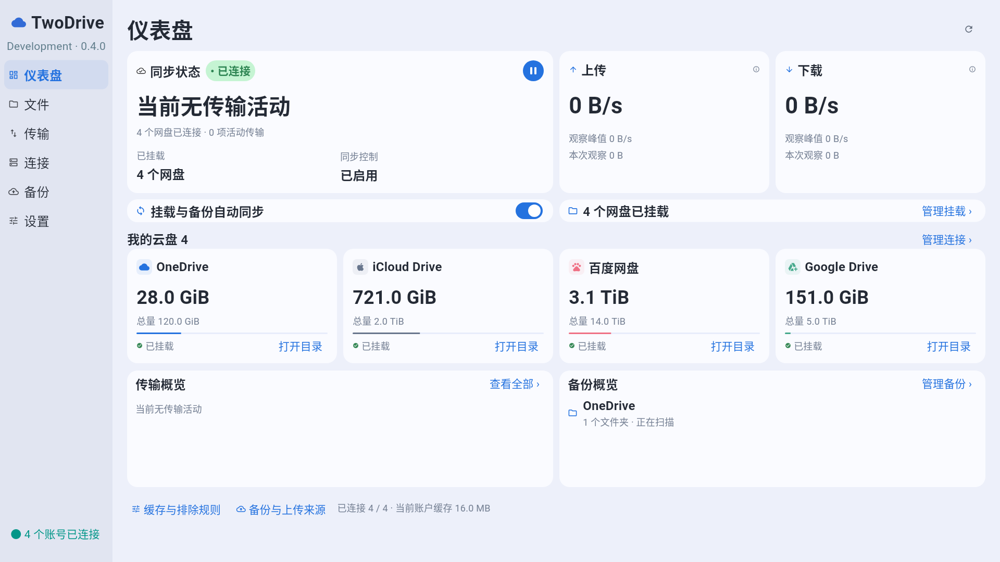

# TwoDrive Development 桌面界面参考

以下截图为简体中文的 1920 × 1080 工作区，文字缩放为 150%。截图由当前 `apps/dav` 的 Flutter 页面渲染，使用示例网盘、目录、文件和备份任务。Windows 移植可对照共享页面的布局、操作位置和控件层级。系统窗口装饰由各平台 runner 管理。

| 页面 | 截图 |
| --- | --- |
| 仪表盘 | [overview.png](overview.png) |
| 连接 | [connections.png](connections.png) |
| 文件 | [files.png](files.png) |
| 传输 | [transfers.png](transfers.png) |
| 备份 | [backup.png](backup.png) |
| 设置 | [settings.png](settings.png) |

